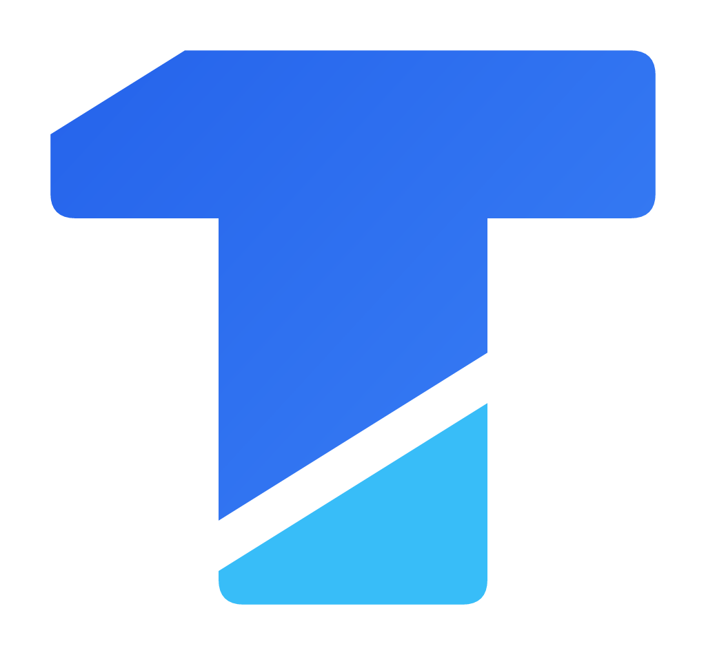

# TechStore — Manual de identidad

Versión 1.0 · 2026-10-18 · Fuente de verdad de los archivos: [`generador/generar-marca.mjs`](generador/generar-marca.mjs)

## 1. Estrategia

**Qué es TechStore.** Una tienda de hardware y periféricos de Paraguay que vende en el local, con reparto propio y por la app. Sus clientes arman o mejoran una computadora, equipan una oficina o reponen un accesorio. El sistema que la sostiene se ocupa de lo mismo que cualquier mostrador honesto: que el precio que se ve sea el que se cobra, que el stock que se muestra exista y que cada pedido se pueda seguir.

**Propuesta de valor.** Tecnología con precio claro y stock real. Antes de proponerla se miró el código: la app ya se niega a mostrar grande un precio que no es el que se cobra y solo dice «quedan N» cuando N es escasez de verdad. La marca dice en voz alta lo que el sistema ya hace.

**Personalidad.** Precisa, nocturna, directa. Sabe de técnica y no presume. Habla como alguien de confianza detrás del mostrador: con voseo, sin exagerar y explicando el porqué.

**Valores.**
- *Claridad*: el precio final, el stock real y el estado del pedido, siempre a la vista.
- *Criterio*: se recomienda lo que sirve y se dice lo que no hay.
- *Cuidado*: cada pedido tiene a alguien detrás, desde el mostrador hasta el reparto.

**Concepto creativo: «Vitrina nocturna».** La tienda de noche, con las luces de la calle apagadas y cada producto iluminado en su vitrina por una luz azul. Sobre esa base va la reinterpretación de Monokai, el esquema de color de los editores de código: un lienzo negro donde el color no decora, *significa*. En el código el azul marca las palabras clave; acá marca lo que se puede tocar y lo que importa. Los colores clásicos de Monokai (verde, naranja, rosa, amarillo) quedan reservados para los estados: disponible, aviso, error y promoción.

**Eslogan.** «Precio claro. Stock real.» Se usa en la presentación de la marca y en la pantalla de ingreso, no en cada pantalla.

**Identidad verbal.**

| Sí | No |
|---|---|
| «Quedan 2 unidades» | «¡¡Últimas unidades, apurate!!» |
| «No pudimos cargar el catálogo. Revisá tu conexión.» | «Error 500» |
| «Te pasamos los datos al confirmar el pedido» | «Procesando su solicitud» |
| Voseo: ingresá, revisá, elegí | Tuteo o usted mezclados |

El tono sube un poco en la vidriera, que puede ser editorial, y baja del todo en los errores, que tienen que ser útiles antes que simpáticos.

> El nombre «TechStore» es el que ya usa el proyecto y se conserva. **No se verificó su disponibilidad marcaria** en la DINAPI ni en otros registros: antes de invertir en cartelería o registrarlo, hay que consultarlo.

## 2. Logotipo

### Isotipo: la T comentada

Una T maciza atravesada por un corte diagonal. El corte y el chaflán de la esquina superior izquierda son **paralelos** (32°) y forman un `//`, la marca de comentario del código: el lugar donde un programador explica el porqué. El fragmento de abajo, en cian, es **el cursor**: la única parte de la marca que se mueve.

Lectura doble, a propósito: de lejos y en 16 px es una T firme; de cerca aparece el `//` y el cursor.

Va sin el nombre adentro. La razón social se edita desde Admin → Empresa, y un isotipo con el nombre quedaría contradiciendo a la factura el día que el negocio cambie de nombre.

### Versiones

| Archivo | Uso |
|---|---|
| `isotipo.svg` | Sobre fondos negros u oscuros (uso principal) |
| `isotipo-claro.svg` | Sobre blanco y papel: azules más profundos, cursor `#0284C7` |
| `isotipo-mono.svg` | Una tinta (`currentColor`): ícono temático de Android 13, sellos, bordados |
| `isotipo-insignia.svg` | Dentro de su cuadrado negro: favicon, avatar y redes. Funciona sobre cualquier fondo |
| `logotipo.svg` / `logotipo-claro.svg` | Solo el nombre, en curvas: no depende de tener la fuente instalada |
| `imagotipo-horizontal(-claro).svg` | Isotipo + nombre en línea: barras, encabezados, firmas |
| `imagotipo-vertical(-claro).svg` | Isotipo sobre el nombre: portadas, splash, cartelería |

Los PNG de cada versión están en `recursos/png/`.

### Logotipo

«TechStore» en Space Grotesk Bold con el espaciado apretado (−20 milésimas de em), en dos tonos: **Tech** en el color del texto y **Store** en azul. Son dos palabras con dos colores, como el resaltado de sintaxis de un editor. Se convierte a curvas en cada archivo.

### Área de resguardo y tamaños mínimos

- Alrededor de cualquier versión se deja libre al menos **la mitad de la altura de la mayúscula** del logotipo. Los SVG ya incluyen ese margen.
- Isotipo: mínimo **16 px** en pantalla y **6 mm** impreso.
- Imagotipo horizontal: mínimo **96 px** de ancho; por debajo se usa el isotipo solo.

### Usos incorrectos

- Separar el cursor de la T o cambiar el ángulo del corte.
- Rellenar la T con degradados ajenos a la paleta, ponerle sombras paralelas o contornos.
- Usar la versión para fondo oscuro sobre blanco (el cian sobre blanco da 2,14:1 y se lava).
- Escribir el nombre con otra tipografía o en un solo color cuando hay espacio para los dos tonos.
- Rotar, deformar o apoyar el isotipo sobre una foto sin su insignia.

## 3. Color

### Paleta de marca

| Rol | Hex | Uso |
|---|---|---|
| Fondo absoluto | `#000000` | Fondo de toda la app; el negro domina |
| Negro principal | `#080A10` | Barras, navegación, bloques que se separan del fondo |
| Negro azulado | `#0B1120` | Paneles, tarjetas, campos de texto |
| Superficie secundaria | `#111827` | Tarjetas elevadas, diálogos |
| Superficie elevada | `#172033` | Hojas, menús, avisos flotantes |
| Azul eléctrico | `#2563EB` | Relleno de la acción principal |
| Azul principal | `#3B82F6` | Estados activos, foco, indicadores |
| Azul luminoso | `#60A5FA` | Enlaces y acentos de texto sobre negro |
| Cian tecnológico | `#38BDF8` | El cursor: insignias, contadores, cursor de texto |
| Texto principal | `#F8FAFC` | Texto |
| Texto secundario | `#94A3B8` | Texto de apoyo, íconos inactivos |
| Bordes | `#253247` | Divisiones y filos decorativos |

### Colores derivados

| Rol | Hex | Motivo |
|---|---|---|
| Borde de control | `#5B6D8A` | Los campos y botones con contorno necesitan 3:1 para reconocerse como controles, y lo tienen contra todas las superficies oscuras: 4,0:1 sobre el negro, 3,6:1 sobre el relleno de los campos y 3,1:1 sobre la tarjeta elevada. El borde de la paleta (1,63:1) solo decora |
| Azul tinta (papel) | `#1D4ED8` | Isotipo sobre blanco |
| Cursor sobre papel | `#0284C7` | El cian se lava sobre blanco |

### Estados: la sintaxis Monokai

| Estado | Hex | Contraste sobre negro |
|---|---|---|
| Disponible, éxito | `#A6E22E` | 13,54:1 |
| Aviso, poco stock | `#FD971F` | 9,62:1 |
| Error | `#F92672` | 5,55:1 |
| Promoción | `#E6DB74` | 14,75:1 |

Se usan solo para comunicar un estado y siempre acompañados de texto o ícono: el color nunca carga el mensaje solo.

### Contrastes comprobados (WCAG 2.1)

| Par | Contraste | Para |
|---|---|---|
| Texto principal sobre negro | 20,07:1 | Todo texto |
| Texto secundario sobre negro / sobre `#172033` | 8,19:1 / 6,34:1 | Texto de apoyo |
| Azul luminoso sobre negro | 8,26:1 | Enlaces, acentos |
| Azul principal sobre negro | 5,71:1 | Texto de acento (AA) |
| Azul eléctrico sobre negro | 4,06:1 | Solo íconos y texto grande |
| Blanco sobre azul eléctrico | 5,17:1 | Texto de botón principal (AA) |
| Blanco sobre azul principal | 3,68:1 | **No usar** para texto |
| Tinta `#001A26` sobre cian | 8,34:1 | Contadores e insignias |

## 4. Tipografía

| Familia | Rol | Pesos |
|---|---|---|
| **Space Grotesk** | Títulos, precios, el logotipo | 500, 600, 700 |
| **Inter** | Todo el texto de la interfaz | 400, 500, 600, 700 |
| **JetBrains Mono** | Rótulos «de código», números de pedido y factura | 500, 700 |

Las tres tienen licencia SIL Open Font License 1.1 y van dentro de la app con sus licencias.

**Regla del signo ₲:** Inter y Space Grotesk lo traen; JetBrains Mono no. Por eso **un importe nunca se escribe en mono**. Los precios van en Space Grotesk con cifras tabulares, para que las columnas de montos no bailen.

**El rótulo comentado.** Los rótulos de sección van en JetBrains Mono, en minúscula, precedidos por `//` en cian: `// recién llegados`. Es el mismo `//` del isotipo, llevado al texto. Se usa uno por bloque, nunca dos seguidos.

Escala (puntos lógicos): titular de vidriera 40–52 · titular de pantalla 28–32 · título de bloque 22 · cuerpo 14–16 · apoyo 12–13 · rótulo 11–12.

## 5. Geometría, superficies e iconografía

- **El corte de 32°** es el gesto de la marca. Aparece en el isotipo y, como esquina cortada, en las etiquetas de precio y en las tarjetas destacadas. No se usa en botones ni en campos, que tienen que verse como controles.
- **Radios:** 10 (chips, etiquetas) · 14 (botones, campos) · 20 (tarjetas) · 28 (hojas y diálogos).
- **Superficies:** cinco niveles, del negro absoluto a `#172033`. Sobre negro no se usa sombra para elevar: se usa el siguiente nivel de superficie más un filo de `#253247`. Las únicas sombras son de luz azul, debajo de la acción principal y detrás de los productos.
- **Espaciado:** grilla de 4. Márgenes de pantalla de 20, separación entre bloques de 32 a 40.
- **Íconos:** Material Symbols en su versión de trazo redondeado, 24 px, en texto secundario cuando están inactivos y en azul luminoso cuando están activos.

## 6. Movimiento

La marca se mueve como un cursor: aparece, se ubica y se queda quieta.

- **Entradas en cascada**, de 40 a 60 ms entre elementos, con desplazamiento corto (12–24 puntos) y curva de salida rápida.
- **Duraciones:** 120 ms para la respuesta al toque, 200–320 ms para los cambios de estado, 450–700 ms para las escenas (presentación de un producto, vidriera).
- **El producto viaja**: de la tarjeta a su ficha (elemento compartido) y, al agregarlo, del botón al carrito.
- **Nada infinito.** No hay animaciones en bucle salvo los indicadores de carga, que mueren con la carga. El carrusel de la vidriera avanza solo mientras está a la vista.
- **Accesibilidad:** si el sistema tiene activado «Quitar animaciones», todo pasa a cortes simples sin desplazamiento.

## 7. Aplicaciones

| Pieza | Archivo | Detalle |
|---|---|---|
| Ícono de la app | `techstore-mobile/assets/branding/icono_app_*.png` | Adaptativo: frente, fondo con halo azul y capa monocroma para Android 13. El isotipo entra en el círculo seguro de 66 dp |
| Splash | `splash_isotipo.png` | Negro absoluto con el isotipo de 137 dp, igual en Android 12+ y anteriores; la app lo continúa sin salto |
| Favicon y barra de la web | `techstore-frontend/public/isotipo.svg` | La insignia |
| Logos de la web | `public/logo.svg`, `public/logo-blanco.svg` | Imagotipo horizontal, claro y oscuro |
| Factura, nota de crédito, KuDE | `techstore-backend/.../logo/isotipo.png` | Variante para papel, sin cuadrado |

Para cambiar algo, se edita el generador y se vuelve a correr (instrucciones en su encabezado). Ningún PNG se retoca a mano.
